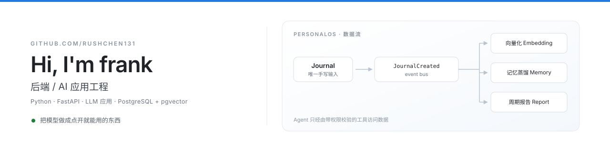
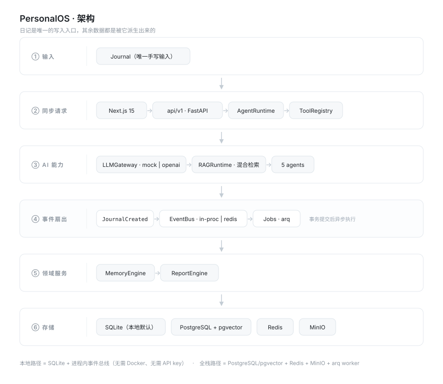

  

---

### 关于我

- 🔭 在做 **[PersonalOS](https://github.com/rushChen131/personalOS)**：以日记为唯一输入的个人生活操作系统，自动蒸馏长期记忆、生成周期报告
- 🧩 关注：RAG 检索质量、Agent 工具权限边界、事件驱动架构
- 🌱 在补：可观测性、LLM 应用评测这套基本功
- 💬 可以聊：Python / FastAPI，以及 LLM 落地时那些不太体面的细节

### 技术栈

### 代表项目

**[PersonalOS](https://github.com/rushChen131/personalOS)** · 个人生活操作系统
日记是唯一需要手写的输入，`JournalCreated` 事件扇出到向量化与记忆蒸馏；聊天 Agent 只能通过带权限校验的工具访问数据。同一套代码支持本地 SQLite（零依赖启动）与 PostgreSQL + pgvector / Redis / MinIO 全栈部署。

`FastAPI` `Next.js 15` `PostgreSQL + pgvector` `Redis` `SSE` `多 Agent 编排`

**[NutriMind-AI](https://github.com/rushChen131/NutriMind-AI-backend)** · AI 菜谱对话助手
Taro 小程序 + RAG 检索 + OpenAI 兼容模型，按一份 PRD 从零实现到可验收，前后端分仓（[frontend](https://github.com/rushChen131/NutriMind-AI-frond)）。
`Taro` `FastAPI` `Chroma` `RAG` `LLM`

### GitHub

---

把复杂的事做成一件事 —— 这样比较好维护。 
<a href="README.en.md">English</a> · 中文

